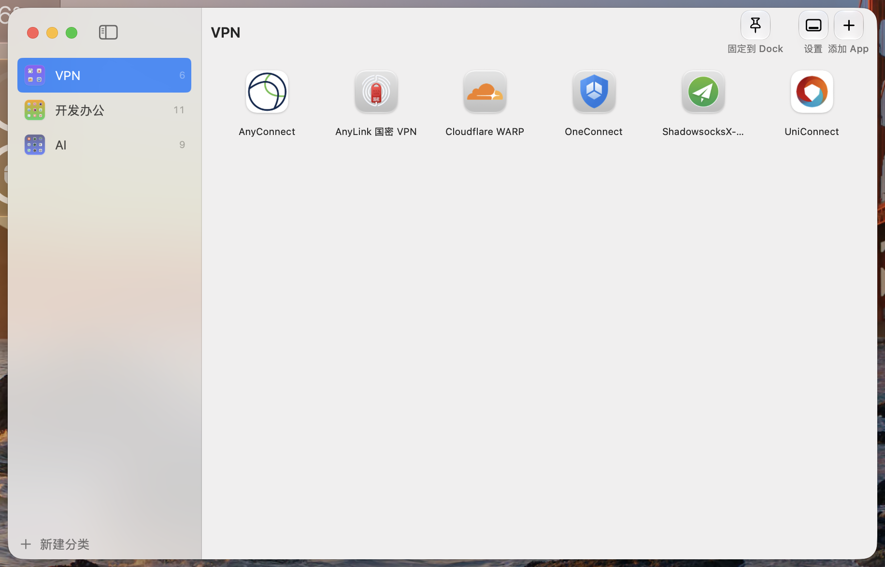
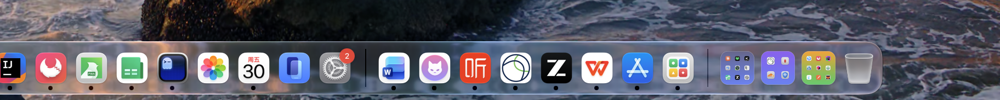
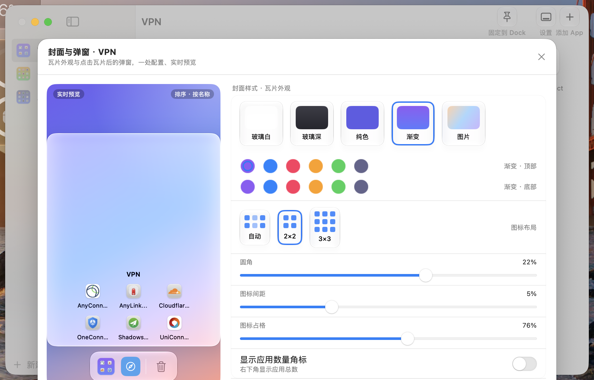
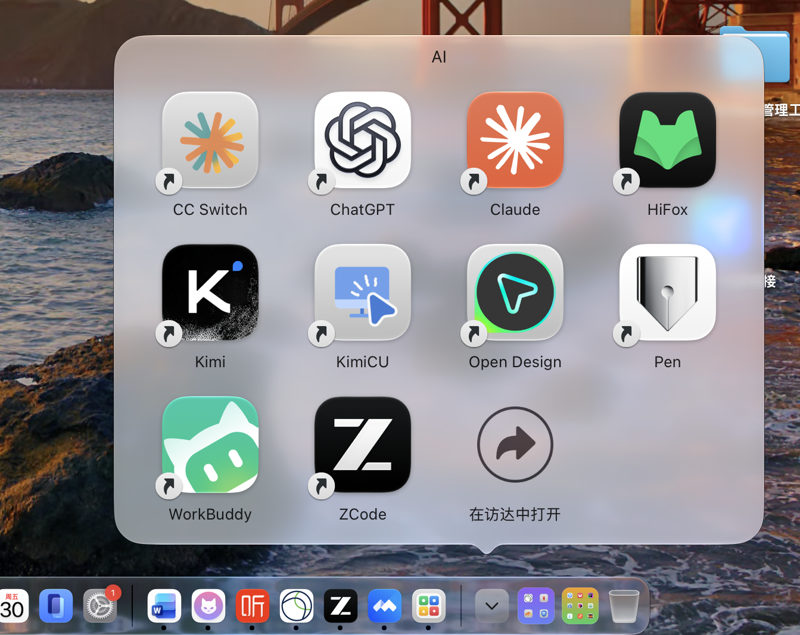

# MiniDock · 微程序坞

[English](README.en.md) | 中文

> macOS 26+ 的程序坞不好分类找 App？MiniDock 把常用 App 按「分类文件夹」装进 Dock：
> 文件夹图标是合成的**玻璃马赛克缩略图**（显示内部 App 图标），点击弹出**系统原生玻璃网格**，
> 点任意图标即刻启动。Dock 在哪个屏幕（含副屏），弹窗就出现在哪个屏幕——全部由系统定位，零适配。

**免费开源**（MIT），所有功能无限制，界面支持**简体中文 / English** 双语言（跟随系统语言）。










## 功能特性

- **分类管理**：新建/重命名/删除分类，从已安装应用搜索勾选添加，或直接拖 `.app` 进窗口，拖动排序
- **玻璃马赛克封面**：底板（玻璃白/玻璃深/纯色/双色渐变/自定义图片）、布局（自动/2×2/3×3）、圆角/间距/占格滑杆、数量角标——实时预览
- **Dock 弹窗参数**：弹窗样式（自动/扇形/网格/列表）、排序（含「按我的排序」）、图标大小（跟随系统默认最紧凑）
- **一体化设置面板**：「封面与弹窗」合并配置，左侧实时预览舞台（瓦片 + 弹窗联动），右侧系统设置式表单，全控件 Liquid Glass
- **Liquid Glass**：macOS 26 原生 `glassEffect`（工具栏访达式图标胶囊 + 底部标签、设置玻璃卡片），旧系统自动回退
- **健康检查**：真实 App 被删/移动后红色标记，点选修复；引擎带空配置保险丝防误删

## 工作原理

MiniDock 是一个管理器，真正的 Dock 体验由 macOS 原生 Stack 提供：

```
~/Applications/MiniDock/
├── VPN/                  ← 分类文件夹（拖入 Dock / 一键固定）
│   ├── AnyConnect -> /Applications/AnyConnect.app   （符号链接）
│   └── ...
└── .minidock-state.json  ← 引擎状态（图标签名、文件夹映射）
```

- 每个分类 = 一个真实文件夹，内含指向各 App 的**符号链接**（不复制、不移动真实 App）
- 文件夹图标由程序合成写入手工 ICNS（多尺寸 1024→16px 资源分叉），成员变化自动重绘
- 点击 Dock 中的分类图标 → 系统原生网格弹窗 → 点击启动
- 分类名 = 文件夹名（Dock 悬停显示），随时可改

## 构建与打包

```bash
./Scripts/make-app.sh          # release 打包到 build/MiniDock.app（ad-hoc 签名）
./Scripts/make-app.sh debug    # debug 版
./Scripts/make-dmg.sh 1.14     # DMG 安装包（App+Applications 拖装布局，版本号可选）
swift build && swift test      # 仅编译 / 跑测试（33 项）
```

依赖：Xcode 命令行工具（swift 6+、iconutil、sips、codesign），macOS 14+。

## 使用（三步）

1. **建分类**：新建分类并命名，从已安装应用列表搜索、勾选添加（也支持直接把 .app 拖进窗口）
2. **放进 Dock**：点工具栏「固定到 Dock」（会重启 Dock，约 1 秒），或把分类文件夹拖到 Dock 分隔线右侧
3. **点击使用**：点 Dock 中的马赛克图标弹出网格，点任意图标启动

若图标只显示单个应用：右键该图标 → 显示为 → 文件夹。

## 常见问题

- **图标只显示第一个应用**：Dock 瓦片的「显示为」是堆叠模式，右键图标 → 显示为 → 文件夹（固定时已自动写入，极少数情况需手动）
- **弹窗太大/太小**：设置面板 → Dock 弹窗 → 「跟随系统默认大小」（实测最紧凑）
- **强制 2×2 时第 5 个 App 不显示**：2×2 最多显示 4 个图标，多余的自动收纳（3×3 最多 9 个）
- **应用被移动/删除**：管理器里红色标记，点击选新位置即可修复

## 工程结构

```
Sources/MiniDock/
├── MiniDockApp.swift          # 入口 + Dock 图标重开处理
├── AppState.swift             # 全局状态（分类/应用/设置/健康检查）
├── Models/AppConfig.swift     # 配置模型（分类/封面样式/弹窗参数，JSON 持久化）
├── Services/
│   ├── DockSyncEngine.swift   # 文件夹/符号链接/图标 同步引擎（签名增量更新）
│   ├── DockPinner.swift       # 固定到 Dock（dock plist 写入 + 参数校准）
│   ├── FolderIconWriter.swift # 手工 ICNS 资源分叉写入（绕开 IconServices 崩溃）
│   ├── MosaicIconGenerator.swift # 马赛克封面合成
│   └── AppScanner.swift       # 已安装应用扫描
├── Views/                     # 主界面/设置面板/玻璃组件/引导页
└── Resources/en.lproj/        # 英文界面文案（基础语言为简体中文）
Tests/MiniDockTests/           # 33 项单元测试
Scripts/                       # make-app.sh 打包 + make-dmg.sh 安装包 + gen-icon.swift 图标
docs/pitfalls.md               # macOS 26 踩坑记录（工具栏材质/资源分叉/重开事件等）
```

## 安全边界

- 只在 `~/Applications/MiniDock/` 下创建文件夹与**符号链接**，绝不复制、移动或删除任何真实 App
- 删除分类仅删除其文件夹与链接
- Dock 参数只写入 `persistent-others` 的瓦片键（displayas/showas/arrangement/preferreditemsize）

## 许可

[MIT](LICENSE) · 更新日志见 [CHANGELOG.md](CHANGELOG.md)
